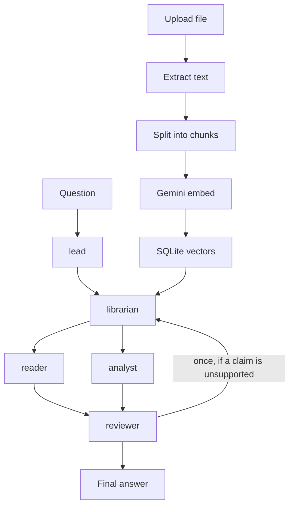

# Architecture

Upload is still one straight line: extract, chunk, embed, store. A question is not. A question runs a LangGraph desk in `backend/desk/graph.py`. Five nodes have different jobs. LangGraph is only the wiring. There is no LangChain agent class and no tool-calling framework.

The browser never talks to Google or Groq. It talks only to the Flask server and reads a stream of agent events. The server holds the API keys.

## Who does what

- **Lead** calls the chat model once and returns JSON: whether the question needs prose, whether it needs rows, and a search query. It does not answer.
- **Librarian** does not call a chat model. It embeds the search query and calls `vector_store.search`. Excel hits are tagged `sheet`. Everything else is tagged `prose`.
- **Reader** sees only prose passages. It returns claims with a filename and a location.
- **Analyst** sees only spreadsheet rows. It may not invent a total that is not in a row.
- **Reviewer** drops any claim the passage does not support. If something was rejected and this is the first pass, it sends the graph back to the librarian once with a tighter query. Then it writes the final answer from the approved claims only. If nothing was approved, the answer is the fixed sentence `I do not know based on the uploaded documents.`

Reader and analyst are started together with LangGraph `Send`. Both always start. When one has nothing to do, its trace status is `skipped`, so the reviewer is not left waiting on a branch that never ran. The reviewer node is added with `defer=True` when that argument exists, so it waits until both branches have finished.

The loop is capped because the librarian increments `revision` when it begins the retry. The reviewer will not ask for a second retry.

## Graph state

- `question`, `top_k`, `search_query`, `need_reader`, `need_analyst`
- `passages` from the librarian
- `claims` — a list reducer, so reader and analyst can both append in the same step. The librarian writes a reset marker before they run, so a retry does not keep rejected claims.
- `approved`, `rejected`, `revision` (0, then 1), `revise`
- `answer`, `sources`
- `trace` — a list reducer of `{agent, status, summary}`
- `run_id` — key into an in-memory queue used to stream events. The queue itself is not inside the state.

## What is stored

The database file is `backend/data/rag.sqlite` unless `DATA_DIR` points somewhere else. Two tables:

`documents`

- `id` — hex id
- `filename` — original name, used in citations
- `filetype` — `.pdf`, `.docx`, `.xlsx`, or `.txt`
- `uploaded_at` — UTC timestamp
- `chunk_count`

`chunks`

- `id`
- `document_id` — points at `documents.id`
- `chunk_index` — 0, 1, 2, … across that file
- `location` — `page 3`, `sheet Sales, row 12`, `document`, or `file`
- `text` — the chunk itself
- `embedding_json` — the 768 floats as a JSON array

The original upload is deleted after indexing. Only the extracted text and the vector remain.

## What is sent to Google

On upload, one HTTP POST per chunk:

`POST https://generativelanguage.googleapis.com/v1beta/models/gemini-embedding-2:embedContent`

The body is the chunk prefixed as `title: filename | text: ...`, plus `"output_dimensionality": 768`.

On a question, the librarian makes one embedding POST for the lead's search query. The question is prefixed as `task: question answering | query: ...`. Embedding 2 has no `task_type` argument, so the task has to be written into the string.

Then the lead, the reader, the analyst, and the reviewer each make chat calls when they actually run. A skipped specialist does not. The reviewer's last step, when it has approved claims, is one more chat call through `generate_answer`. A question that needs both file types is several calls. Keep the demo files short.

If `LLM_PROVIDER` is `gemini`, those chat calls are:

`POST https://generativelanguage.googleapis.com/v1beta/models/gemini-3.8-flash:generateContent`

JSON agents send `responseMimeType: application/json`. Thinking stays at `GEMINI_THINKING_LEVEL`, default `low`.

## What is sent to Groq

Only chat steps, and only when `LLM_PROVIDER=groq`. Embeddings stay on Gemini. The librarian never calls Groq.

`POST https://api.groq.com/openai/v1/chat/completions`

Default model: `openai/gpt-oss-20b`. JSON agents send `response_format: json_object`.

## How search works

`vector_store.search` loads every chunk, decodes the JSON vector, and scores it with cosine similarity against the query vector. The librarian asks for `min(max(top_k * 2, 8), 12)` hits so a spreadsheet does not disappear behind a long PDF. Each specialist then keeps at most `top_k` passages of its own kind. `TOP_K` defaults to 4.

Cosine similarity divides the dot product by the lengths of the two vectors. Gemini Embedding 2 already normalizes a 768-dimension vector, so the score is mostly about direction. Closer to 1 means a closer match. The score is returned to the browser rounded to 4 decimal places, next to a short excerpt, so you can show that retrieval happened before the language model wrote anything.

A few hundred chunks is the size this design is for. It reads the whole table on every question. That is the right trade for a talk: the ranking code is short enough to put on a slide. It is the wrong trade for a large production corpus.

## Where Chroma would plug in

Chroma is a vector database with the same three jobs this file does: add, query, delete. Its install is large, and the distance math sits inside the library. For the talk, `backend/vector_store.py` is the vector database.

If you later swap in Chroma, replace the bodies of `add_document`, `search`, `list_documents`, and `delete_document`. Keep those names. `rag.ingest_file` and `librarian_node` call those names. You would still call `embeddings.py` yourself and pass the vectors in, so Chroma would not download its own ONNX model.

## What this project leaves out

- No OCR. A scanned PDF, which is a picture of a page, has no text layer and is rejected.
- No `.doc` or `.xls`. Those older binary formats need extra libraries. Use `.docx` and `.xlsx`.
- No local embedding model and no PyTorch.
- No NumPy. Cosine similarity is a plain loop.
- No LangChain agent classes. LangGraph's `StateGraph` is the one orchestration dependency.
- No chat memory. Each question is a new graph run.
- No login. Anyone who can reach the server can upload and ask. Put it behind a private URL for a demo, and do not leave a public server up with your API key.

Excel formula cells are readable only when the file already contains the cached calculated value. `openpyxl` does not evaluate formulas.
